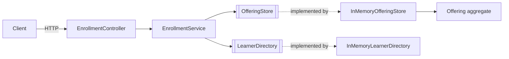
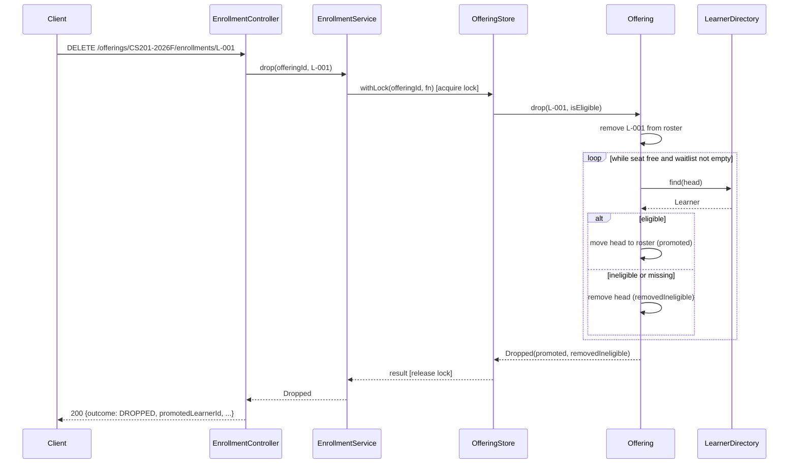

# Course Waitlist — Design Specification

Scope: enrollment, drop, and FIFO waitlist promotion for **one course
offering**, as a minimal Spring Boot 3 REST service with an in-memory store.
No starter project was supplied, so this uses the fallback the assessment
allows. Everything outside that slice (catalog, identity, payments, multi-term,
database, frontend, deployment) is out of scope.

## 1. Requirements

### Functional

- **FR-1** An eligible learner who requests enrollment while a seat is free is
  enrolled.
- **FR-2** An eligible learner who requests enrollment while the offering is
  full joins the back of the waitlist.
- **FR-3** A learner has at most one active record (enrolled or waitlisted)
  per offering. Repeated requests never create a second record.
- **FR-4** A learner who has not completed every prerequisite is neither
  enrolled nor waitlisted.
- **FR-5** Dropping an enrolled learner frees a seat, and the earliest eligible
  waitlisted learner is promoted into it.
- **FR-6** During promotion, a waitlisted learner who is no longer eligible is
  removed from the waitlist and the scan continues with the next learner.
- **FR-7** A waitlisted learner can leave the waitlist through the drop request.
- **FR-8** Duplicate, repeated, and invalid requests return a clear result and
  leave enrollment, capacity, and waitlist state unchanged.
- **FR-9** The current roster, waitlist, and free seats can be read.

### Non-functional

| ID | Requirement | Target | Verified by |
|----|-------------|--------|-------------|
| NFR-1 | Invariants (section 6) hold under concurrent requests | 0 violations with 32 threads × 200 requests | Concurrency tests |
| NFR-2 | Waitlist order equals the order in which requests are applied | Exact FIFO in tests | FIFO and concurrency tests |
| NFR-3 | Durability | None. State is lost on restart (accepted, section 12) | — |

Latency and throughput targets are not set: a single in-memory offering
protected by one lock is far below any realistic load, and the assessment
grades correctness, not performance.

## 2. Decisions and assumptions

Each decision was proposed with options, then chosen by the candidate. The
option analysis is recorded in [AI_USAGE.md](AI_USAGE.md).

| ID | Question | Decision |
|----|----------|----------|
| D-1 | Prerequisite rule | The offering lists prerequisite course codes. A learner is eligible when their completed courses include **all** of them. |
| D-2 | When eligibility is checked | **Twice**: when the learner requests enrollment, and again when they reach the front of the waitlist during promotion. |
| D-3 | Ineligible learner at the front of the waitlist | **Skip and remove.** The learner is removed from the waitlist (reported as `removedIneligible`) and promotion continues with the next learner. |
| D-4 | Meaning of "a learner may enroll only once" | **One active record at a time.** After dropping, a learner may request again and is treated as a new request (seat if free, else back of the waitlist). No history is kept. |
| D-5 | Enroll while already enrolled | No-op, `ALREADY_ENROLLED`. |
| D-6 | Enroll while already waitlisted | No-op, `ALREADY_WAITLISTED` with the current position. The learner keeps their place. |
| D-7 | Drop while waitlisted | Learner leaves the waitlist, `LEFT_WAITLIST`. No promotion, because no seat opened. |
| D-8 | Drop while neither enrolled nor waitlisted (repeated or never) | No-op, `NOT_ENROLLED`. A repeated drop never frees a second seat. |
| D-9 | Waitlist size | Unbounded. |
| D-10 | Delivery shape | Spring Boot 3 REST service. Domain logic is plain Java with no Spring dependency. |
| D-11 | Concurrency | One `ReentrantLock` per offering around every read-modify-write. |

Further assumptions:

- **A-1** Learners and the offering are seeded from `application.yml`. There is
  no endpoint to create learners or change their completed courses. Tests
  change completions directly on the in-memory learner directory to produce the
  "became ineligible while waiting" case.
- **A-2** A learner who disappears from the directory while waitlisted is
  treated as ineligible at promotion (removed, per D-3).
- **A-3** Eligibility is not re-checked for learners who are already enrolled.
  Revoking a completion does not un-enroll anyone (section 12).
- **A-4** Callers are trusted: there is no authentication, so any caller can
  enroll or drop any learner ID (identity integration is out of scope).
- **A-5** Capacity is fixed at startup and is at least 1.

### Why skip-and-remove (D-3)

| Option | Problem |
|--------|---------|
| Block the queue until the head is eligible | The seat stays empty, contradicting "promote the earliest eligible learner". |
| Skip but keep the learner in place | A free seat can coexist with a non-empty waitlist of ineligible learners, and stale entries are rescanned on every drop. |
| **Skip and remove** | The learner loses their place if the problem was temporary; they can re-request and join at the back. Accepted. |

Skip-and-remove keeps invariant I-3 strict ("a free seat implies an empty
waitlist") and makes promotion amortized O(1), since each skipped learner is
removed exactly once.

## 3. Service boundary and API

The service owns one offering's roster and waitlist. It reads learner
completion data from a learner directory it does not own (an in-memory stand-in
here). Base path: `/offerings/{offeringId}`.

### Endpoints

| Method | Path | Body | Purpose |
|--------|------|------|---------|
| `POST` | `/offerings/{offeringId}/enrollments` | `{"learnerId": "L-001"}` | Request enrollment |
| `DELETE` | `/offerings/{offeringId}/enrollments/{learnerId}` | — | Drop, or leave the waitlist |
| `GET` | `/offerings/{offeringId}` | — | Read capacity, free seats, roster, waitlist |

`learnerId` must match `^[A-Za-z0-9-]{1,64}$`.

### Outcomes

| Request | State before | Outcome | HTTP | State change |
|---------|--------------|---------|------|--------------|
| Enroll | No record, seat free, eligible | `ENROLLED` | 201 | Added to roster |
| Enroll | No record, full, eligible | `WAITLISTED` + position | 202 | Added to back of waitlist |
| Enroll | No record, ineligible | `PREREQUISITES_NOT_MET` + missing courses | 422 | None |
| Enroll | Enrolled | `ALREADY_ENROLLED` | 200 | None |
| Enroll | Waitlisted | `ALREADY_WAITLISTED` + position | 200 | None |
| Drop | Enrolled | `DROPPED` + promoted learner (if any) + removed ineligible learners | 200 | Seat freed, promotion run |
| Drop | Waitlisted | `LEFT_WAITLIST` | 200 | Removed from waitlist |
| Drop | No record | `NOT_ENROLLED` | 200 | None |
| Any | Malformed or blank learner ID | `INVALID_REQUEST` | 400 | None |
| Any | Learner ID not in directory | `LEARNER_NOT_FOUND` | 404 | None |
| Any | Unknown offering ID | `OFFERING_NOT_FOUND` | 404 | None |

Enroll checks run in this order, and the first match decides the outcome:
learner exists → already enrolled → already waitlisted → eligible → seat free.
Duplicate checks come before the eligibility check, so a retry from an
enrolled learner always reports `ALREADY_ENROLLED`.

Waitlist positions are 1-based.

### Response bodies

Success (2xx):

```json
{
  "outcome": "DROPPED",
  "learnerId": "L-001",
  "waitlistPosition": null,
  "promotedLearnerId": "L-004",
  "removedIneligibleLearnerIds": ["L-003"]
}
```

Errors (4xx) use RFC 7807 `ProblemDetail`, with `outcome` as an extra
property. `PREREQUISITES_NOT_MET` also carries `missingPrerequisites`:

```json
{
  "type": "about:blank",
  "title": "Prerequisites not met",
  "status": 422,
  "detail": "Learner L-005 has not completed all prerequisites",
  "instance": "/offerings/CS201-2026F/enrollments",
  "outcome": "PREREQUISITES_NOT_MET",
  "missingPrerequisites": ["CS101"]
}
```

Response bodies never include stack traces or internal messages.

## 4. Domain model

All domain types are plain Java with no framework imports.

| Type | Kind | Responsibility |
|------|------|----------------|
| `LearnerId`, `OfferingId`, `CourseCode` | record | Validated identifiers |
| `Learner` | record | Learner ID and completed courses; reports missing prerequisites |
| `Offering` | class (aggregate) | Holds capacity, prerequisites, roster, and waitlist; applies enroll, drop, and promotion rules; enforces invariants. Not thread-safe; callers hold the offering lock. |
| `EnrollResult` | sealed interface | `Enrolled`, `Waitlisted(position)`, `AlreadyEnrolled`, `AlreadyWaitlisted(position)`, `PrerequisitesNotMet(missing)` |
| `DropResult` | sealed interface | `Dropped(promoted, removedIneligible)`, `LeftWaitlist`, `NotEnrolled` |
| `OfferingSnapshot` | record | Immutable copy of the offering state for reads |
| `LearnerNotFoundException`, `OfferingNotFoundException` | exception | Invalid references, mapped to 404 |

Business outcomes, including rejections, are result values. Exceptions are used
only for references that do not exist, so every outcome in the table above is
explicit in the method signatures.

## 5. Components

| Component | Layer | Responsibility | Depends on |
|-----------|-------|----------------|------------|
| `Offering` | domain | Applies enrollment rules to one offering's state | JDK |
| `EnrollmentService` | application | Runs each request atomically against the offering, with learner lookups | `OfferingStore`, `LearnerDirectory` |
| `OfferingStore` | application port (out) | Runs a function against an offering while holding its lock | — |
| `LearnerDirectory` | application port (out) | Looks up a learner by ID | — |
| `InMemoryOfferingStore` | adapter.out.memory | Keeps offerings with one fair `ReentrantLock` each | port |
| `InMemoryLearnerDirectory` | adapter.out.memory | Keeps learners in a `ConcurrentHashMap` | port |
| `EnrollmentController` | adapter.in.web | Maps HTTP to service calls and results to status codes | `EnrollmentService` |
| `GlobalExceptionHandler` | adapter.in.web | Maps validation and not-found errors to `ProblemDetail` | — |
| `WaitlistProperties` | config | Binds and validates the seeded offering and learners | — |
| `WaitlistConfiguration` | config | Builds the stores, seeds them, and wires the service | all |

### Extension points

The two outbound ports are the only interfaces. They keep storage out of the
domain, so a database adapter could replace the in-memory one by implementing
`OfferingStore.withLock` as a transaction with a row lock. The eligibility and
waitlist policy are deliberately **not** pluggable: the assessment asks for a
stated policy, not a policy engine. There are no config-selected
implementations.

## 6. Invariants

These hold after every operation, and tests assert them after every step:

| ID | Invariant |
|----|-----------|
| I-1 | `enrolled.size() <= capacity` |
| I-2 | No learner appears in both the roster and the waitlist, and neither contains duplicates |
| I-3 | If `enrolled.size() < capacity`, the waitlist is empty |
| I-4 | The waitlist keeps the order in which learners joined |
| I-5 | Every enrolled or waitlisted learner was eligible when last checked |
| I-6 | A request with a no-op or error outcome leaves the state exactly as it was |

I-3 also means a new eligible learner can never take a free seat ahead of
someone already waiting: if a seat is free, nobody is waiting.

## 7. Waitlist promotion rule

When an enrolled learner drops:

```
remove learner from roster
while roster.size < capacity and waitlist is not empty:
    head = remove first learner from waitlist
    if head is in the directory and has completed every prerequisite:
        add head to roster            (promoted)
    else:
        record head as removedIneligible
```

The loop is written against the general condition rather than "promote
exactly one", so I-3 holds even if several ineligible learners are at the
front. Each waitlisted learner is examined at most once over their lifetime,
so promotion is amortized O(1).

## 8. Storage

| Store | Key | Value | Atomicity | Memory bound |
|-------|-----|-------|-----------|--------------|
| Offerings | `OfferingId` | `Offering` (roster and waitlist as `LinkedHashSet`) + `ReentrantLock` | Every change runs inside the offering's lock | One offering; unbounded waitlist (D-9) |
| Learners | `LearnerId` | `Learner` record | `ConcurrentHashMap` per-key replacement | Seeded set |

`LinkedHashSet` gives insertion order (FIFO) with O(1) `contains` and
`remove`, so duplicate checks and leaving the waitlist do not scan.

## 9. Concurrency and consistency

- `EnrollmentService` calls `OfferingStore.withLock(offeringId, fn)`, which
  holds the offering's lock for the whole check-then-act sequence: duplicate
  checks, eligibility, seat check, insert, and the full drop-and-promote loop.
  The lock is released in a `finally` block.
- Learner lookups happen **inside** the lock, so the eligibility seen at
  promotion is the value at that moment.
- The lock is fair (`new ReentrantLock(true)`), so waiting requests acquire it
  roughly in arrival order. Waitlist order is defined as the order in which
  requests acquire the lock. Network arrival order is not observable to the
  service.
- Reads (`GET`) also take the lock and return an immutable `OfferingSnapshot`,
  so a reader never sees a half-applied drop and promotion.
- Consistency is strong (linearizable) within one JVM. There is one lock per
  offering, not a global lock.
- No time-dependent logic exists, so no `Clock` is needed.

Races covered by tests: many learners competing for the last seats, and the
same learner sending concurrent enroll requests.

## 10. Configuration

```yaml
app:
  waitlist:
    offering:
      id: CS201-2026F
      capacity: 2
      prerequisites: [CS101]
    learners:
      - id: L-001
        completed-courses: [CS101]
      - id: L-005
        completed-courses: []
```

| Property | Type | Rule | Runtime-changeable |
|----------|------|------|--------------------|
| `app.waitlist.offering.id` | string | Matches the ID pattern | No |
| `app.waitlist.offering.capacity` | int | ≥ 1 | No |
| `app.waitlist.offering.prerequisites` | list of course codes | May be empty | No |
| `app.waitlist.learners[].id` | string | Unique, matches the ID pattern | No |
| `app.waitlist.learners[].completed-courses` | list of course codes | May be empty | No (tests change it in memory) |

Invalid configuration fails at startup through `@Validated` properties.

## 11. Observability and security

- One INFO log line per state change: enrolled, waitlisted, dropped, left
  waitlist, promoted, removed as ineligible. Lines contain learner and offering
  IDs only, no personal data.
- No metrics, health checks, or tracing beyond Spring defaults; they add
  nothing to this slice.
- Input validation on the learner ID pattern at the web boundary (400).
- No authentication (A-4), no secrets, no outbound connections.

## 12. Limitations and follow-up risks

Known from the design:

- State lives in memory and is lost on restart (NFR-3).
- No authentication: any caller can drop any learner (A-4).
- A learner removed as ineligible loses their waitlist place, even if the
  problem was temporary (D-3).
- Enrolled learners are not re-checked when a completion is revoked (A-3).
- The waitlist is unbounded (D-9).
- Fairness is per lock acquisition; the fair lock lowers throughput, which is
  irrelevant at this scale but would matter with a real store.
- The single-JVM lock does not protect multiple service instances. A database
  adapter would need a row lock or optimistic version check.

Found during implementation:

- **Promotion is not rolled back if a learner lookup throws.** The dropping
  learner is removed before the promotion loop runs. Each head's eligibility is
  checked before that head is removed, so a throwing lookup leaves that head on
  the waitlist, but the drop is not undone and I-3 can be broken until the next
  drop. The in-memory directory cannot throw. A remote directory would need the
  lookups done first, or a rollback.
- **Learner lookups run inside the offering lock.** This is what makes the
  eligibility read current (D-2), but a slow remote directory would hold the
  lock and serialize every request behind it. A real directory needs a timeout
  and a decision on fail-closed versus fail-open.
- **A learner deleted from the directory while enrolled cannot drop.** The drop
  request returns `404 LEARNER_NOT_FOUND` and the seat stays taken. The seeded
  directory never deletes learners, so this cannot happen in the running service.
- **Ineligible-at-head can only be produced in tests.** There is no endpoint to
  change completed courses (A-1), so the running service only reaches D-3
  through test code that edits the in-memory directory.
- **Removed learners are told only through the drop response and the log.**
  The learner who is removed is not notified; only the caller who dropped sees
  `removedIneligibleLearnerIds`.
- **`202 Accepted` for `WAITLISTED` is a convention choice.** It signals "not
  done yet", but clients must read `outcome`, not only the status code, to tell
  a waitlist entry from other 2xx results.
- **The concurrency tests are evidence, not proof.** They use 32 threads and up
  to 200 learners. Running them with the lock removed made all four fail in 3
  of 3 runs, which shows they detect missing mutual exclusion, but they cannot
  rule out every interleaving.

## 13. Package layout

```
com.example.registration.waitlist
├── WaitlistApplication
├── domain
│   ├── LearnerId, OfferingId, CourseCode, Identifiers, Learner
│   ├── Offering, OfferingSnapshot
│   ├── EnrollResult, DropResult
│   └── LearnerNotFoundException, OfferingNotFoundException
├── application
│   ├── EnrollmentService
│   └── port.out
│       ├── OfferingStore
│       └── LearnerDirectory
├── adapter
│   ├── in.web
│   │   ├── EnrollmentController, EnrollmentRequest, EnrollmentResponse
│   │   ├── OfferingResponse, Outcome
│   │   └── GlobalExceptionHandler
│   └── out.memory
│       ├── InMemoryOfferingStore
│       └── InMemoryLearnerDirectory
└── config
    ├── WaitlistProperties
    └── WaitlistConfiguration
```

Maven coordinates: `com.example.registration:course-waitlist`.

## 14. Diagrams

### Components



### Drop with promotion



## 15. Test plan (acceptance criterion 6)

| Criterion area | Test | Level |
|----------------|------|-------|
| Available capacity | Eligible learner enrolled while seats remain | Domain |
| Full capacity | Eligible learner waitlisted with correct position when full | Domain |
| Duplicate requests | Re-enroll while enrolled / while waitlisted is a no-op; state unchanged | Domain |
| FIFO promotion | Several waitlisted; drops promote in join order | Domain |
| Prerequisite failure | Ineligible learner rejected with missing courses; not waitlisted | Domain |
| Ineligible at head (D-3) | Head loses eligibility, drop removes them and promotes the next eligible | Domain |
| All waitlisted ineligible | Drop removes all, seat stays free, waitlist empty (I-3) | Domain |
| Leave waitlist (D-7) | Waitlisted learner drops; no promotion; order of others kept | Domain |
| Invalid / repeated drops | Second drop is `NOT_ENROLLED` and promotes nobody; unknown learner is 404 | Domain + Web |
| Re-enroll after drop (D-4) | Dropped learner re-requests and is treated as new | Domain |
| Invariants | I-1..I-6 asserted after each step | Domain |
| Concurrency | 32 threads, distinct learners, capacity C: exactly C enrolled, rest waitlisted, no duplicates | Service + memory store |
| Concurrency | Same learner, concurrent enroll requests: one record | Service + memory store |
| HTTP contract | Status code and body for every outcome row in section 3; `ProblemDetail` for 400/404/422 | Full context + MockMvc (`@SpringBootTest`) |
| Config | Invalid capacity fails startup | Context runner |

## 16. Implementation plan

| # | Files | Layer | Tests |
|---|-------|-------|-------|
| 1 | `pom.xml`, `WaitlistApplication`, `application.yml` | build | Context loads |
| 2 | `LearnerId`, `OfferingId`, `CourseCode`, `Learner` | domain | Validation |
| 3 | `EnrollResult`, `DropResult`, `OfferingSnapshot`, exceptions | domain | — |
| 4 | `Offering` | domain | Rules, promotion, invariants (rows 1–11 of section 15) |
| 5 | `OfferingStore`, `LearnerDirectory` | application port | — |
| 6 | `InMemoryOfferingStore`, `InMemoryLearnerDirectory` | adapter.out | Lock contract |
| 7 | `EnrollmentService` | application | Concurrency tests |
| 8 | `WaitlistProperties`, `WaitlistConfiguration` | config | Invalid config fails startup |
| 9 | `EnrollmentController`, DTOs, `GlobalExceptionHandler` | adapter.in.web | MockMvc per outcome |
| 10 | `README.md`, section 12 final pass | docs | Commands run as written |
